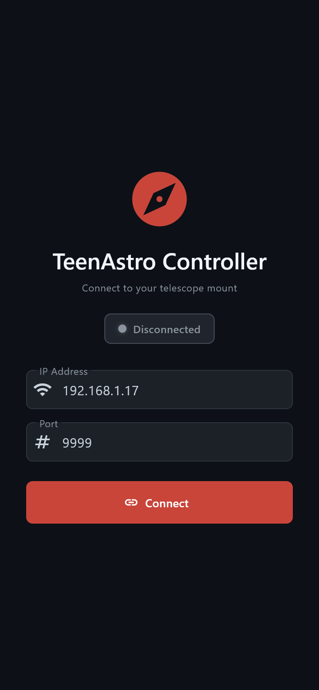
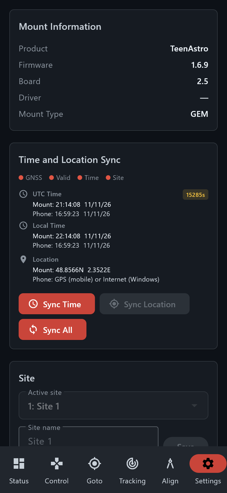

# Android app

> Groups.io: https://groups.io/g/TeenAstro/wiki/43283

The Android app is **TeenAstro Controller**. It drives the mount over Wi‑Fi with the same LX200 dialogue as the hand controller and as SkySafari. Version **1.6.2**. The phone does not replace the hand controller’s buttons, and it does not flash firmware.

Turn Wi‑Fi on at the hand controller (**Telescope Settings → Wifi**). The phone joins the same network. In access-point mode the address is **192.168.0.1** and the factory password is **password**. In station mode use the address from **Show IP**. The port is **9999**. The two modes are on the [WiFi Interface](https://groups.io/g/TeenAstro/wiki/14592) page.

The first screen asks for that address and port. A full address such as `http://192.168.0.1:9999` is accepted in the address field. The last address is remembered. **Connect** opens the mount. If the link drops, the app retries.

Six tabs sit along the bottom: **Status**, **Control**, **Goto**, **Tracking**, **Align**, **Settings**.

- [Status](https://groups.io/g/TeenAstro/wiki/APP_STATUS) — pointing, time, target
- [Control](https://groups.io/g/TeenAstro/wiki/APP_CONTROL) — slew, park, home, flip, focuser
- [Goto](https://groups.io/g/TeenAstro/wiki/APP_GOTO) — coordinates and catalogs
- [Planetarium](https://groups.io/g/TeenAstro/wiki/APP_PLANETARIUM) — sky chart
- [Tracking](https://groups.io/g/TeenAstro/wiki/APP_TRACKING) — rate and fine adjust
- [Alignment](https://groups.io/g/TeenAstro/wiki/APP_ALIGN) — 2 Stars, 4 Stars, 3+3, mechanical
- [Phone finder](https://groups.io/g/TeenAstro/wiki/APP_FINDER) — plate solve with the phone camera

The chart is dark. **Night view**, in Settings, shifts the whole app toward red.

**Mount Information** is what the mount reports. Three named sites can be selected and renamed. **Time and Location Sync** compares the phone clock with the mount and can send the time. **Sync Location** sends the phone’s position. The mount accepts a new site only at home or parked. **Sync All** sends time and place. **From GNSS** asks the mount to take its own satellite fix. **Disconnect** returns to the address screen.

Motor gear, current, limits and the Wi‑Fi password stay on the hand controller or on the [web server](https://groups.io/g/TeenAstro/wiki/8105). Firmware is flashed with TeenAstroUploader.

Field manuals: [EN](https://github.com/charleslemaire0/TeenAstro/blob/Release_1.6/docs/manuel/Manuel_utilisateur_en.pdf) · [FR](https://github.com/charleslemaire0/TeenAstro/blob/Release_1.6/docs/manuel/Manuel_utilisateur_fr.pdf) · [DE](https://github.com/charleslemaire0/TeenAstro/blob/Release_1.6/docs/manuel/Manuel_utilisateur_de.pdf). Plate solving is chapter 23.
