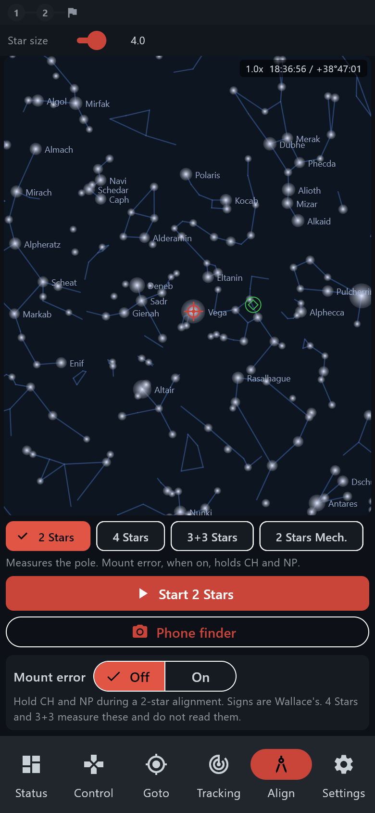

# Android app — Alignment

> Groups.io: https://groups.io/g/TeenAstro/wiki/43289

**Align** runs the same alignments as the hand controller.

- **2 Stars** measures the pole. **Mount error**, when on, holds CH and NP.
- **4 Stars** uses four stars on one pier side, or four stars spread around the sky on an alt-azimuth mount. It measures NP.
- **3+3 Stars** is three stars, a flip, then three more. It measures CH and NP. A German equatorial mount is the one that flips.
- **2 Stars Mech.** is two stars, then the pole bolts.

Pick the kind, then **Start**. The chart offers named stars. Center the star and accept it. **Abort** restores the previous model. At the end, **Save to EEPROM** keeps the model. **Remove alignment** clears it.

**Mount error** is Off or On, the same switch as on the hand controller. Signs are Wallace’s. **4 Stars** and **3+3 Stars** measure CH and NP. They do not read the stored values.

**Phone finder** on this screen opens the camera plate solve. It does not start the alignment.

Back to the [Android app](https://groups.io/g/TeenAstro/wiki/43283).
