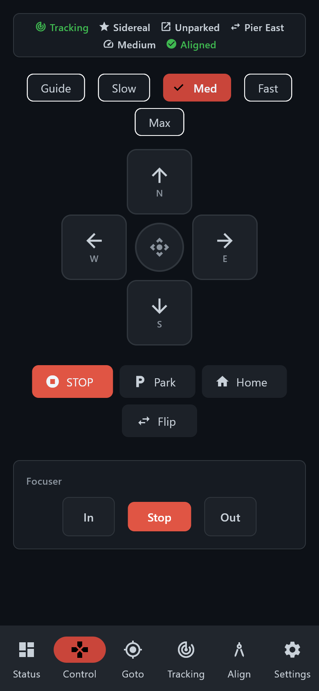

# Android app — Control

> Groups.io: https://groups.io/g/TeenAstro/wiki/43285

**Control** is the hand pad.

Hold a direction to slew: north, south, east, west. Release to stop. Speeds are **Guide**, **Slow**, **Med**, **Fast** and **Max**, the same steps as Set Speed on the hand controller.

**STOP** aborts a motion. During a goto the button reads **STOP SLEW**. **Park** and **Unpark**, **Home**, and **Flip** (meridian flip on a German equatorial mount) are under the pad. A focuser moves with **In**, **Out** and **Stop**.

Back to the [Android app](https://groups.io/g/TeenAstro/wiki/43283).
