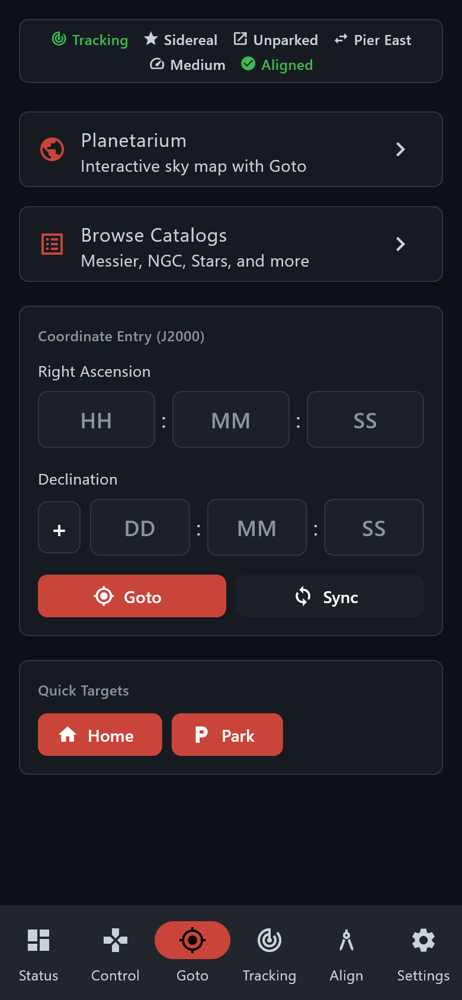
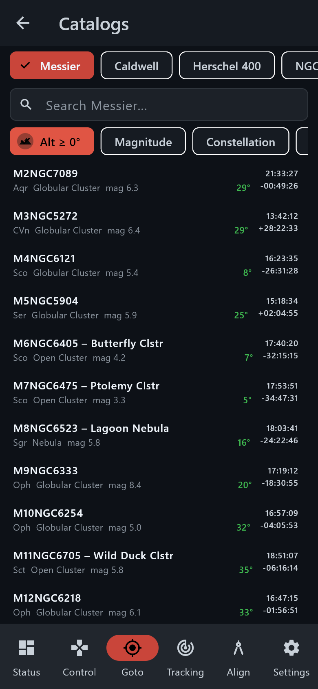

# Android app — Goto

> Groups.io: https://groups.io/g/TeenAstro/wiki/43286

**Goto** chooses a target. One goto at a time. A second goto, from the phone or from the hand controller, interrupts the first.

**Planetarium** opens the sky chart. **Browse Catalogs** opens the object lists. The chart has its own page: [Planetarium](https://groups.io/g/TeenAstro/wiki/APP_PLANETARIUM).

**Coordinate Entry (J2000)** takes hours, minutes and seconds of right ascension, and degrees, minutes and seconds of declination. **Goto** slews. **Sync** tells the mount that the telescope is already on those coordinates. **Stop**, **Home** and **Park** are on the same page.

## Catalogs

**Browse Catalogs** lists Messier, Caldwell, Herschel 400, NGC, IC, bright stars, Struve (STF), Struve appendix (STT) and the GCVS variable-star catalog. Search by name. Filters cover altitude above the horizon, magnitude and constellation. Double stars can be filtered by separation. Variables can be filtered by period. Tap an object to go to it.

Back to the [Android app](https://groups.io/g/TeenAstro/wiki/43283).
