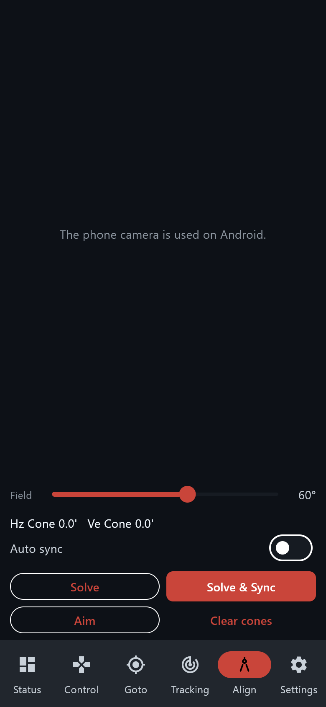

# Android app — Phone finder

> Groups.io: https://groups.io/g/TeenAstro/wiki/43290

**Phone finder** plate-solves with the phone camera. No eFinder, and no `:e` command, is required. Open it from **Status** or from **Align**.

Leave this screen open. The camera is released when you leave it, and **Auto sync** runs only while the screen is open. The phone asks for the camera. The Windows build of the app has no camera; the picture above is the controls, and on Android the preview fills the top.

The finder does not look along the telescope. The difference is two rotations in the telescope frame, the **Hz cone** and the **Ve cone**. Hz is the horizontal cone and Ve is the vertical cone. They belong to the phone clamped on the tube. The same two names are used on every mount.

**Field** is the angle the phone lens covers, from 15° to 90°. The default is 60°. The catalog is stars to magnitude 4.5, so a narrow eyepiece field will not match. Clamp the phone to the tube.

**Aim.** Go to a bright star, center it in the telescope, and sync. Then **Aim** and capture. The screen shows **Hz Cone** and **Ve Cone**. **Clear cones** forgets them. The values stay on the phone.

**Solve** shows the telescope axis once the cones are known, and the camera axis while they are still zero. **Solve & Sync** writes that axis into the mount.

**Auto sync.** Turn it on and leave the Phone finder screen open. When a goto finishes, the phone solves, syncs, and recenters once if the telescope is farther from the target than **Recenter**. The limit runs from 2 to 60 arcminutes and starts at 2. The switch and the limit stay on the phone.

This is the same sequence as **GoTo++** on an eFinder. The phone does not turn GoTo++ on inside the mount.

**Align** offers **2 Stars** and **4 Stars** on every mount, and **3+3 Stars** on a German equatorial mount. The telescope must already be at home. The phone slews and plate-solves; nothing is centered by hand. **3+3 Stars** flips after the third place. The solved position is recorded, and the model is saved when the solves are accepted. **Stop** cancels the session.

Back to the [Android app](https://groups.io/g/TeenAstro/wiki/43283).
