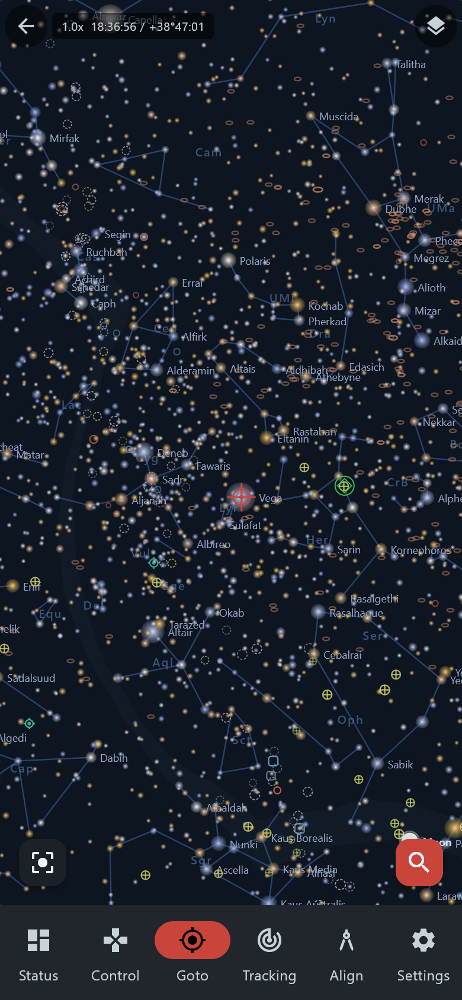

# Android app — Planetarium

> Groups.io: https://groups.io/g/TeenAstro/wiki/43287

The planetarium is the sky now. Open it from **Goto**.

Pinch to zoom, drag to turn the view. The telescope is the red crosshair. A green marker is another selected place. Tap a star or a deep-sky object, then go to it.

Layers are constellation lines and names, the alt-az grid, the equatorial grid, the Milky Way, deep-sky objects, and labels for planets and stars. Star size and object size are adjustable. The readout can be **RA / Dec** or **Alt / Az**.

Back to [Goto](https://groups.io/g/TeenAstro/wiki/APP_GOTO) or the [Android app](https://groups.io/g/TeenAstro/wiki/43283).
