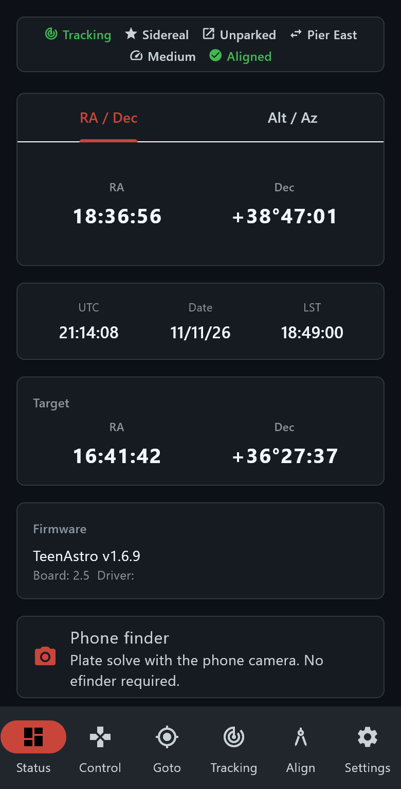

# Android app — Status

> Groups.io: https://groups.io/g/TeenAstro/wiki/43284

**Status** is the home tab. It shows the live mount.

The top line is tracking, the rate, park, pier side, speed and whether an alignment model is stored. If the RTC coin cell on the main unit is empty or missing, that line shows **RTC battery**. Sky gotos and sync stay refused until the time is set.

**RA / Dec** and **Alt / Az** are the telescope pointing. Below that are UTC, the date and local sidereal time, then the current goto target, then the firmware name and board.

**Phone finder** opens the camera plate solve. An eFinder is not required. See [Phone finder](https://groups.io/g/TeenAstro/wiki/APP_FINDER).

Pull down to refresh. Back to the [Android app](https://groups.io/g/TeenAstro/wiki/43283).
