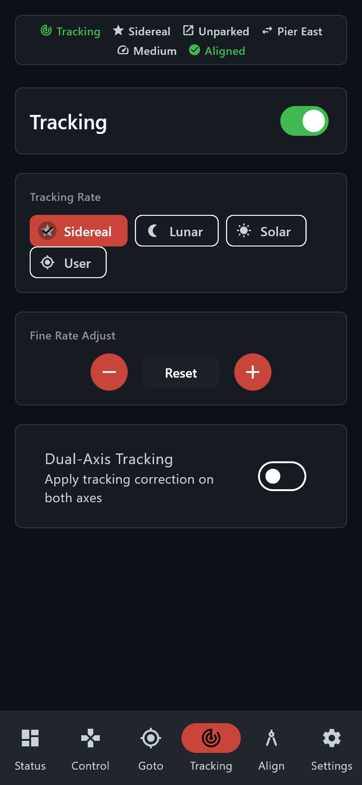

# Android app — Tracking

> Groups.io: https://groups.io/g/TeenAstro/wiki/43288

**Tracking** turns the drive on and sets the rate.

The switch turns tracking on and off. Rates are **Sidereal**, **Lunar**, **Solar** and **User**. **Fine Rate Adjust** nudges the rate up or down, and **Reset** returns it. **Dual-Axis Tracking** applies the correction on both axes.

Back to the [Android app](https://groups.io/g/TeenAstro/wiki/43283).
